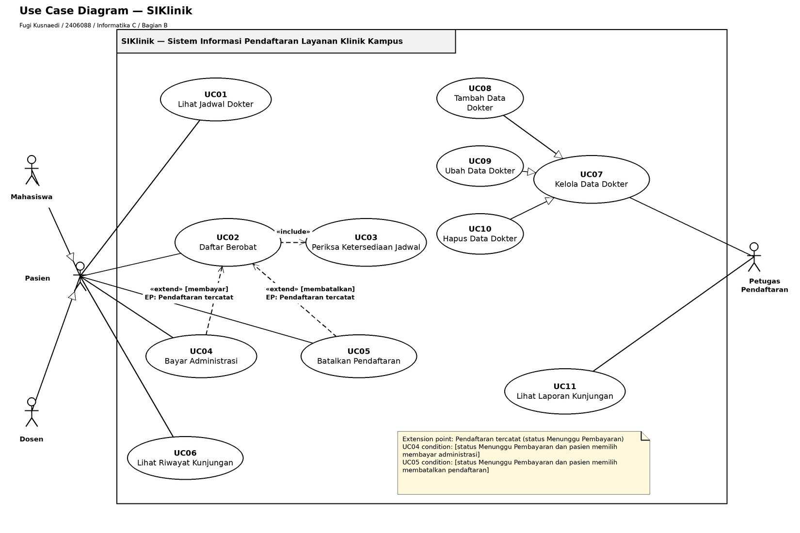
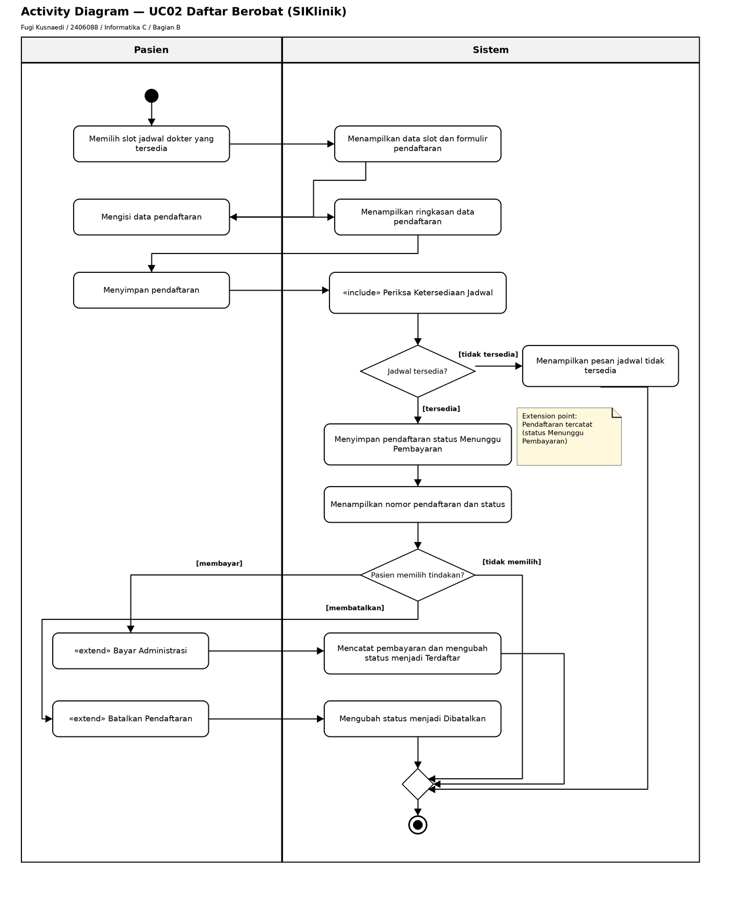

# UTS Praktikum Analisis dan Desain Berorientasi Objek

## Identitas Mahasiswa

| Field | Isi |
|---|---|
| Nama | Fugi Kusnaedi |
| NIM | 2406088 |
| Kelas | Informatika C |
| Bagian yang dikerjakan | **B** (digit terakhir NIM 8, genap) |
| Mata kuliah | Praktikum Analisis dan Desain Berorientasi Objek |
| Program studi / semester | S1 Teknik Informatika / Semester 5 |
| Pertemuan | 8 |
| Hari / tanggal | Kamis–Jumat, 19–20 November 2026 |
| Repository | <https://github.com/igufdev-bijak/UTS-Prak.ABDO-2406088-Informatika-C> |

## Kasus

**SIKlinik — Sistem Informasi Pendaftaran Layanan Klinik Kampus**

Klinik kampus melayani pendaftaran berobat bagi anggota kampus. Pasien, yaitu Mahasiswa dan Dosen, dapat melihat jadwal dokter, mendaftar berobat pada slot yang tersedia, membayar administrasi, membatalkan pendaftaran yang belum dibayar, dan melihat riwayat kunjungan. Petugas Pendaftaran mengelola data dokter dan melihat laporan kunjungan.

## Daftar Berkas

| Folder | Berkas | Keterangan |
|---|---|---|
| `01_usecase` | [`UTS_2406088_B_usecase_v01.drawio`](01_usecase/UTS_2406088_B_usecase_v01.drawio) | Sumber Use Case Diagram (draw.io) |
| `01_usecase` | [`UTS_2406088_B_usecase_v01.png`](01_usecase/UTS_2406088_B_usecase_v01.png) | Hasil ekspor Use Case Diagram |
| `02_skenario` | [`UTS_2406088_B_skenario_v01.drawio`](02_skenario/UTS_2406088_B_skenario_v01.drawio) | Tabel Use Case Skenario UC02 |
| `03_activity` | [`UTS_2406088_B_activity_v01.drawio`](03_activity/UTS_2406088_B_activity_v01.drawio) | Sumber Activity Diagram (draw.io) |
| `03_activity` | [`UTS_2406088_B_activity_v01.png`](03_activity/UTS_2406088_B_activity_v01.png) | Hasil ekspor Activity Diagram |

---

## Tugas 1 — Use Case Diagram

### Aktor

| Aktor | Kedudukan |
|---|---|
| `Pasien` | Aktor umum untuk seluruh layanan pasien |
| `Mahasiswa` | Aktor khusus, generalisasi dari `Pasien` |
| `Dosen` | Aktor khusus, generalisasi dari `Pasien` |
| `Petugas Pendaftaran` | Aktor mandiri |

`Mahasiswa` dan `Dosen` tidak diberi perilaku berbeda oleh narasi, sehingga keduanya digambarkan sebagai aktor khusus yang mewarisi seluruh asosiasi `Pasien`.

### Use Case

| ID | Nama Use Case | Aktor / Peran |
|---|---|---|
| UC01 | Lihat Jadwal Dokter | Pasien |
| UC02 | Daftar Berobat | Pasien; include UC03; diperluas UC04 dan UC05 |
| UC03 | Periksa Ketersediaan Jadwal | Perilaku yang di-include oleh UC02 |
| UC04 | Bayar Administrasi | Pasien; extend ke UC02 |
| UC05 | Batalkan Pendaftaran | Pasien; extend ke UC02 |
| UC06 | Lihat Riwayat Kunjungan | Pasien |
| UC07 | Kelola Data Dokter | Petugas Pendaftaran; use case umum UC08–UC10 |
| UC08 | Tambah Data Dokter | Petugas Pendaftaran; generalisasi dari UC07 |
| UC09 | Ubah Data Dokter | Petugas Pendaftaran; generalisasi dari UC07 |
| UC10 | Hapus Data Dokter | Petugas Pendaftaran; generalisasi dari UC07 |
| UC11 | Lihat Laporan Kunjungan | Petugas Pendaftaran |

### Relasi

| No | Jenis Relasi | Dari | Ke |
|---:|---|---|---|
| 1 | Asosiasi | Pasien | UC01 Lihat Jadwal Dokter |
| 2 | Asosiasi | Pasien | UC02 Daftar Berobat |
| 3 | Asosiasi | Pasien | UC04 Bayar Administrasi |
| 4 | Asosiasi | Pasien | UC05 Batalkan Pendaftaran |
| 5 | Asosiasi | Pasien | UC06 Lihat Riwayat Kunjungan |
| 6 | Asosiasi | Petugas Pendaftaran | UC07 Kelola Data Dokter |
| 7 | Asosiasi | Petugas Pendaftaran | UC11 Lihat Laporan Kunjungan |
| 8 | Generalisasi aktor | Mahasiswa | Pasien |
| 9 | Generalisasi aktor | Dosen | Pasien |
| 10 | Generalisasi use case | UC08 Tambah Data Dokter | UC07 Kelola Data Dokter |
| 11 | Generalisasi use case | UC09 Ubah Data Dokter | UC07 Kelola Data Dokter |
| 12 | Generalisasi use case | UC10 Hapus Data Dokter | UC07 Kelola Data Dokter |
| 13 | Include | UC02 Daftar Berobat | UC03 Periksa Ketersediaan Jadwal |
| 14 | Extend | UC04 Bayar Administrasi | UC02 Daftar Berobat |
| 15 | Extend | UC05 Batalkan Pendaftaran | UC02 Daftar Berobat |

**Condition dan extension point untuk relasi extend:**

| Relasi | Condition | Extension Point |
|---|---|---|
| UC04 → UC02 | `[status pendaftaran Menunggu Pembayaran dan pasien memilih membayar administrasi]` | `Pendaftaran tercatat` |
| UC05 → UC02 | `[status pendaftaran Menunggu Pembayaran dan pasien memilih membatalkan pendaftaran]` | `Pendaftaran tercatat` |

Jumlah relasi: **7 asosiasi + 2 generalisasi aktor + 3 generalisasi use case + 1 include + 2 extend = 15 relasi**.

---

## Tugas 2 — Use Case Skenario

Use case yang dipilih: **UC02 Daftar Berobat**.

Alasan pemilihan:

- Memiliki relasi **include** wajib ke UC03 Periksa Ketersediaan Jadwal.
- Memiliki **decision** dengan dua cabang, yaitu jadwal tersedia dan tidak tersedia.
- Memiliki dua perilaku **extend**, yaitu Bayar Administrasi dan Batalkan Pendaftaran.
- Cukup kaya untuk menunjukkan skenario normal, alternatif, dan akhir dengan penomoran berlanjut.

Berkas tabel: [`02_skenario/UTS_2406088_B_skenario_v01.drawio`](02_skenario/UTS_2406088_B_skenario_v01.drawio)

### Ringkasan Tabel Skenario

**Nama use case:** UC02 Daftar Berobat  
**Aktor:** Pasien (berlaku untuk Mahasiswa dan Dosen)  
**Tujuan:** Pasien memperoleh pendaftaran berobat pada slot jadwal dokter yang tersedia.  
**Deskripsi:** Pasien memilih slot jadwal dokter, mengisi data pendaftaran, dan menyimpan pendaftaran. Sistem menjalankan Periksa Ketersediaan Jadwal sebelum menyimpan. Pendaftaran tersimpan berstatus Menunggu Pembayaran. Setelah itu Pasien dapat memilih membayar administrasi atau membatalkan pendaftaran melalui perilaku extend.

#### Skenario Normal

| No | Kegiatan | Respon Sistem |
|---:|---|---|
| 1 | Pasien membuka fungsi Daftar Berobat dan memilih slot jadwal dokter yang tersedia. | |
| 2 | | Sistem menampilkan data slot (dokter, hari, tanggal, jam) dan formulir pendaftaran. |
| 3 | Pasien mengisi data pendaftaran. | |
| 4 | | Sistem menampilkan ringkasan data pendaftaran. |
| 5 | Pasien menyimpan pendaftaran. | |
| 6 | | Sistem menjalankan Periksa Ketersediaan Jadwal (include UC03). |
| 7 | | Sistem menyimpan pendaftaran dengan nomor pendaftaran dan status **Menunggu Pembayaran**. |
| 8 | | Sistem menampilkan nomor pendaftaran, status, dan pilihan tindakan lanjutan. |

#### Skenario Alternative

| No | Kegiatan | Respon Sistem |
|---:|---|---|
| 9 | Slot jadwal tidak tersedia saat pemeriksaan (cabang dari langkah 6). | |
| 10 | | Sistem menolak penyimpanan dan menampilkan pesan jadwal tidak tersedia; tidak ada pendaftaran tersimpan. |
| 11 | Pasien memilih membayar administrasi (cabang dari langkah 8; condition `[status Menunggu Pembayaran dan pasien memilih membayar]`; extension point `Pendaftaran tercatat`). | |
| 12 | | Sistem mencatat pembayaran administrasi dan mengubah status pendaftaran menjadi **Terdaftar**. |
| 13 | Pasien memilih membatalkan pendaftaran (cabang dari langkah 8; condition `[status Menunggu Pembayaran dan pasien memilih membatalkan]`; extension point `Pendaftaran tercatat`). | |
| 14 | | Sistem mengubah status pendaftaran menjadi **Dibatalkan**. |

#### Skenario Akhir

Use case selesai jika pendaftaran tersimpan dengan status **Menunggu Pembayaran**; status menjadi **Terdaftar** jika Pasien membayar, atau **Dibatalkan** jika Pasien membatalkan; jika jadwal tidak tersedia, tidak ada pendaftaran yang tersimpan.

Langkah 11–14 merupakan perilaku **extend**, bukan langkah wajib UC02. Penomoran langkah berlanjut dari Skenario Normal ke Skenario Alternative.

---

## Tugas 3 — Activity Diagram

Berkas sumber: [`03_activity/UTS_2406088_B_activity_v01.drawio`](03_activity/UTS_2406088_B_activity_v01.drawio)

### Swimlane

| Swimlane | Isi |
|---|---|
| `Pasien` | Memilih slot, mengisi data, menyimpan pendaftaran, dan memilih tindakan lanjutan |
| `Sistem` | Menampilkan formulir/ringkasan, memeriksa ketersediaan, menyimpan, menampilkan status, dan mengubah status |

### Decision dan Guard

| Decision | Guard | Tujuan |
|---|---|---|
| `Jadwal tersedia?` | `[tersedia]` | Menyimpan pendaftaran dan menampilkan status |
| `Jadwal tersedia?` | `[tidak tersedia]` | Menampilkan pesan jadwal tidak tersedia |
| `Pasien memilih tindakan?` | `[membayar]` | Menjalankan extend Bayar Administrasi |
| `Pasien memilih tindakan?` | `[membatalkan]` | Menjalankan extend Batalkan Pendaftaran |
| `Pasien memilih tindakan?` | `[tidak memilih]` | Langsung menuju activity final |

### Konsistensi Skenario dengan Activity

| Langkah skenario | Node activity | Keterangan |
|---:|---|---|
| 1 | `A1 Memilih slot jadwal dokter yang tersedia` | Aksi Pasien |
| 2 | `A2 Menampilkan formulir pendaftaran` | Respon Sistem |
| 3 | `A3 Mengisi data pendaftaran` | Aksi Pasien |
| 4 | `A3B Menampilkan ringkasan data pendaftaran` | Respon Sistem |
| 5 | `A4 Menyimpan pendaftaran` | Aksi Pasien |
| 6 | `A5 «include» Periksa Ketersediaan Jadwal` | Include UC02 → UC03 |
| 7 | `A6 Menyimpan pendaftaran status Menunggu Pembayaran` | Cabang `[tersedia]` |
| 8 | `A7 Menampilkan nomor pendaftaran dan status` | Respon Sistem |
| 9 | `D1 Jadwal tersedia?` → `A12` | Cabang `[tidak tersedia]` |
| 10 | `A12 Menampilkan pesan jadwal tidak tersedia` | Menuju merge dan final |
| 11 | `D2 Pasien memilih tindakan?` → `A8 «extend» Bayar Administrasi` | Cabang `[membayar]` |
| 12 | `A10 Mengubah status menjadi Terdaftar` | Respon Sistem |
| 13 | `D2 Pasien memilih tindakan?` → `A9 «extend» Batalkan Pendaftaran` | Cabang `[membatalkan]` |
| 14 | `A11 Mengubah status menjadi Dibatalkan` | Respon Sistem |
| Akhir | `MERGE` → `FINAL` | Semua cabang bertemu di merge |

Activity diagram menggunakan initial node, decision dengan guard, cabang alternatif, cabang bersyarat untuk perilaku extend, merge, dan activity final node.

---

## Keputusan Pemodelan dan Asumsi

1. **Pasien sebagai aktor umum.** Narasi menyebut “Pasien, yaitu Mahasiswa dan Dosen” tanpa membedakan perilaku, sehingga Mahasiswa dan Dosen dimodelkan sebagai aktor khusus dengan generalisasi ke Pasien.
2. **UC04 dan UC05 sebagai extend.** Pembayaran dan pembatalan bersifat opsional serta terjadi setelah pendaftaran tercatat. Keduanya diperluas ke UC02 dengan extension point `Pendaftaran tercatat`.
3. **Status pendaftaran.** Status yang digunakan adalah `Menunggu Pembayaran`, `Terdaftar`, dan `Dibatalkan`. Pembayaran dan pembatalan hanya berlaku untuk status `Menunggu Pembayaran`.
4. **Include UC03.** Pemeriksaan ketersediaan jadwal adalah perilaku wajib sebelum penyimpanan, sehingga dimodelkan sebagai `«include»`, bukan `«extend»`.
5. **UC03 tanpa asosiasi aktor.** UC03 dijalankan di dalam UC02, sehingga tidak memerlukan asosiasi langsung ke aktor.
6. **CRUD data dokter.** Tambah, ubah, dan hapus data dokter dimodelkan sebagai generalisasi use case dari UC07 Kelola Data Dokter.
7. **Pembayaran diasumsikan berhasil.** Model tidak merinci gateway pembayaran; fokus activity adalah perubahan status setelah Pasien memilih membayar.
8. **Data dokter tidak dirinci.** Narasi tidak menyebut atribut data dokter, sehingga model fokus pada perilaku, bukan struktur data.

## Cara Membuka Berkas

1. Buka [draw.io](https://app.diagrams.net/) atau aplikasi draw.io Desktop.
2. Pilih **File → Open From → Device**, lalu buka berkas `.drawio` yang diinginkan.
3. Berkas `.png` disediakan sebagai hasil ekspor/pratinjau dari sumber `.drawio` yang sama.

## Versi

`v01` — 20 November 2026 — dibuat dengan draw.io (UML 2.5.1).
